# Halsa — System Design & Architecture Document

This document provides a comprehensive technical architecture and system design specification for **Halsa**, a high-fidelity Personal Health Record (PHR) application engineered with an "Ink & Lime" design system, optimistic state persistence with reversible undo queues, and a decoupled FastAPI backend.

---

## 1. High-Level Design (HLD)

### 1.1 System Context (C4 Model Level 1)
The primary actors and external boundaries interacting with Halsa:

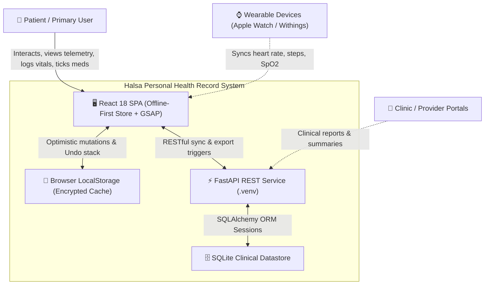

### 1.2 Container Architecture (C4 Model Level 2)
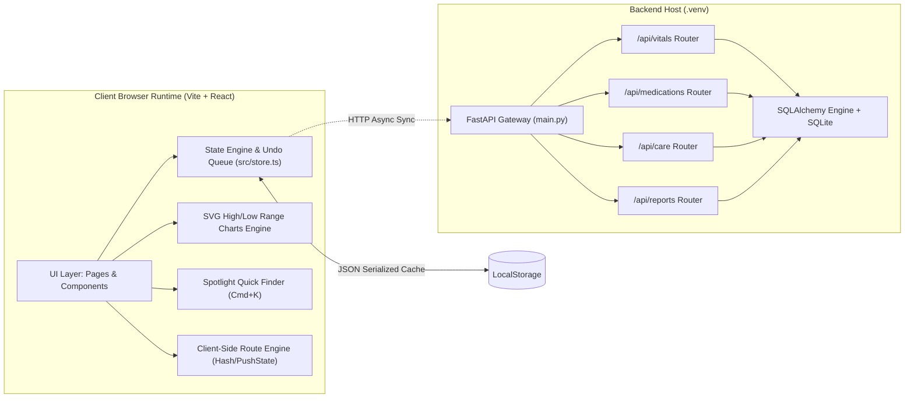

---

## 2. Low-Level Design (LLD)

### 2.1 Component Composition Hierarchy
```
App Shell (src/App.tsx)
├── Aside Sidebar (Desktop Nav: Brand, 11 Nav Links, Badges, Profile Tag)
├── Header TopBar (Quick Finder Trigger, Theme Toggle Sun/Moon)
├── Main Content Body
│   ├── HomePage (4 Metric Tiles, LivePulseLine, 14d Chart, Meds Checklist, BoxBreathing, WaterMeter, NextApt)
│   ├── VitalsPage (Subnav Tabs, RangeSelector, HighLowBarChart, VitalsLogTable, LogVitalModal)
│   ├── ActivityPage (Concentric ActivityRings, Daily Metrics, WorkoutList)
│   ├── SleepPage (SleepScoreHero, HypnogramMultiTrack, SleepStagesLegend)
│   ├── FoodPage (MacroGrid, WaterTracker, MealTimeline, LogMealModal)
│   ├── MedsPage (MedTimeline, StockTracker, RefillButton, 4-Week AdherenceGrid)
│   ├── RecordsPage (SubTabs, LabRangeSlider, ScanCards, VaccineList)
│   ├── CarePage (UpcomingConsultations, ProviderGrid, SlotPicker, BookingModal)
│   ├── ReportsPage (MultiMetric30/90dTrends, CSVExport, PrintStylesheet)
│   ├── SettingsPage (ProfileInputs, UnitToggle, DeviceList, ResetDataButton)
│   └── HelpPage (EmergencyAlertBanner, ClinicalFAQ, MetricExplanations)
├── Mobile BottomTabBar (Small screens only: Home, Vitals, Meds, Care, Settings)
├── ToastUndoQueue (Reversible state action notification & Undo trigger)
└── QuickFinder (Cmd+K spotlight search modal with fuzzy index)
```

---

## 3. Data Flow Diagrams (DFD)

### 3.1 DFD Level 0 — Context Diagram
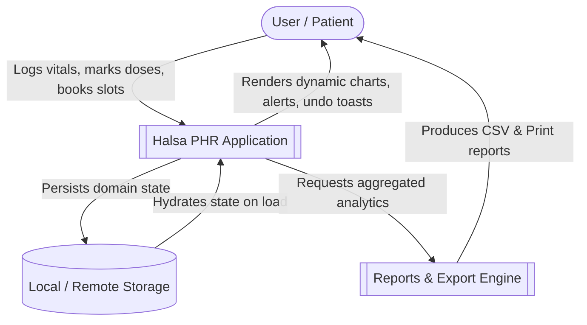

### 3.2 DFD Level 1 — Feature Decomposition
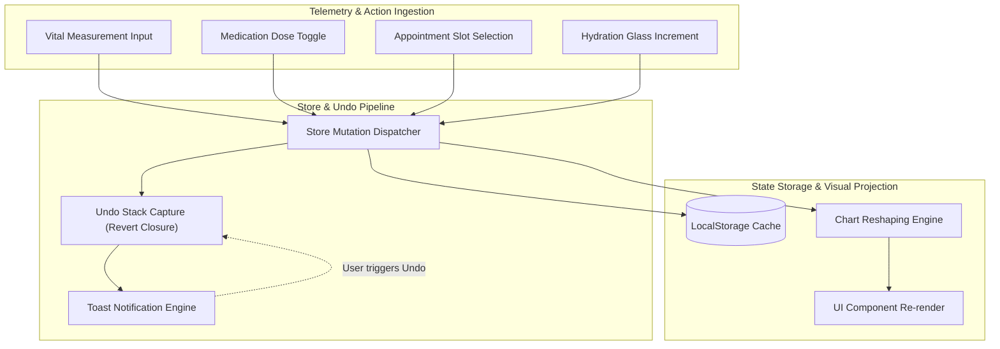

### 3.3 DFD Level 2 — High/Low Chart Normalization Pipeline
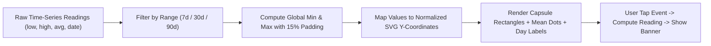

---

## 4. Use Case Diagram

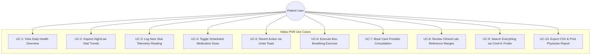

---

## 5. Workflow Diagrams

### 5.1 Medication Adherence & Undo Workflow
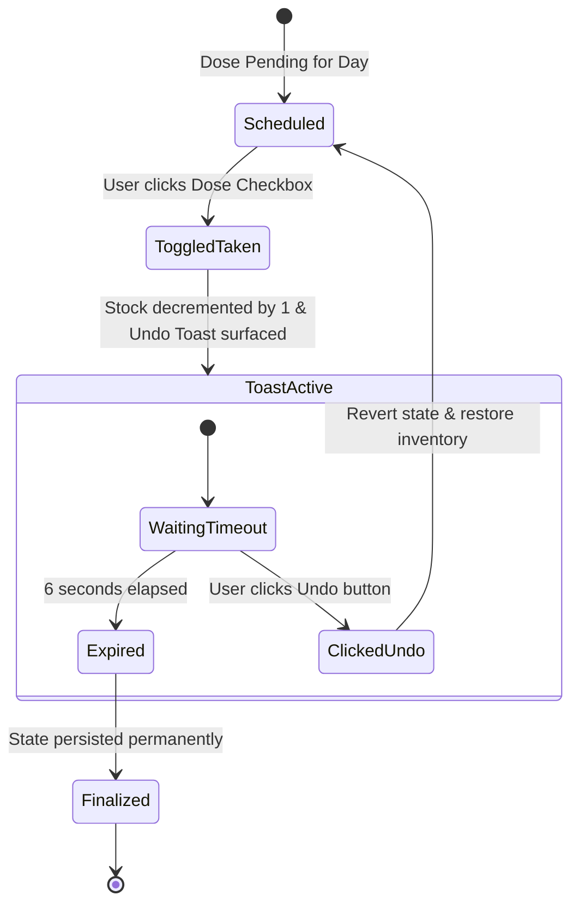

### 5.2 Care Appointment Booking Workflow
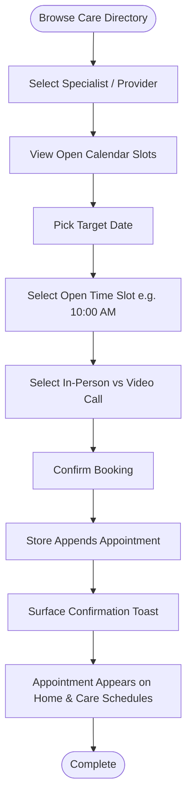

---

## 6. UML Diagrams

### 6.1 Class Diagram (Data Entities & Store)
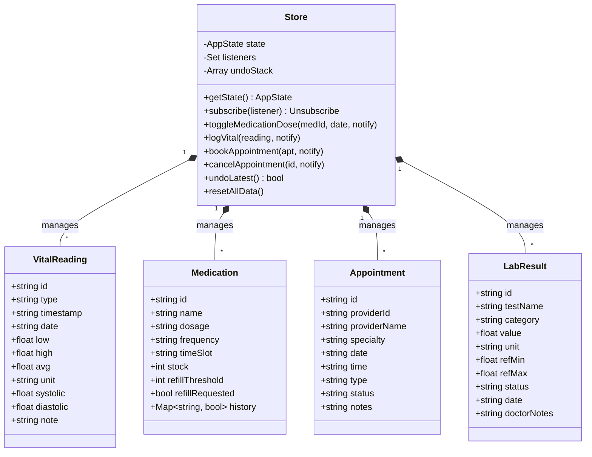

### 6.2 Sequence Diagram: Logging Vital with Undo
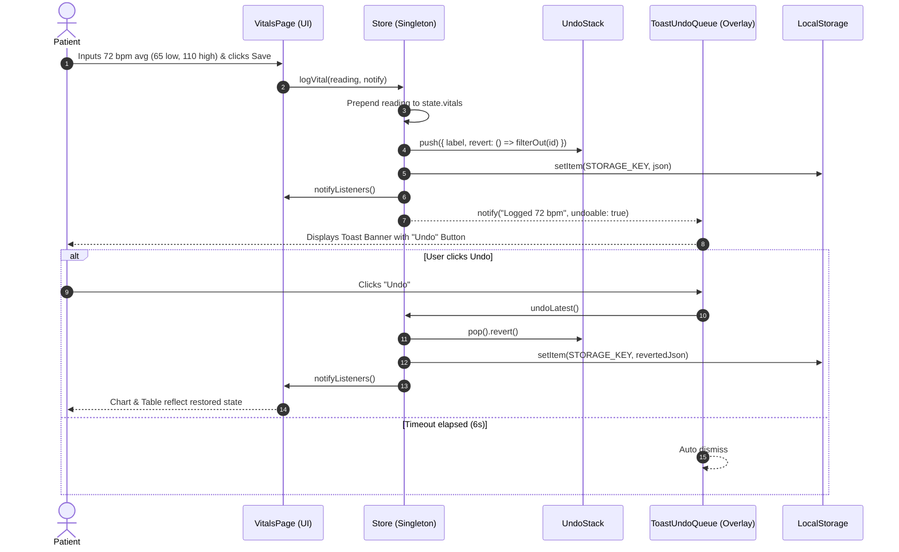

---

## 7. Control Flow Diagram (CFD)

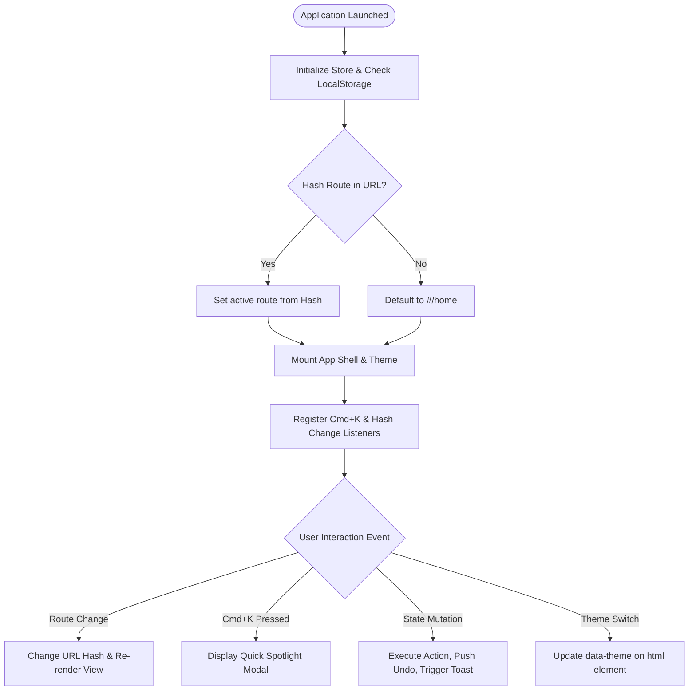

---

## 8. Coupling and Cohesion Analysis

### 8.1 Cohesion Analysis
- **`store.ts` (Functional & Sequential Cohesion)**: High cohesion. Contains solely domain entity schemas, unified state accessors, persistence bridges, and atomic rollback reversers.
- **`charts.tsx` (Functional Cohesion)**: High cohesion. Responsible strictly for SVG coordinate transformations, dynamic bar capsules, mean dot geometry, and interactive hover calculations.
- **`actions.tsx` (Communicational Cohesion)**: Encapsulates user notification toasts and reversible undo callbacks.
- **Page Modules (`pages/*.tsx`) (Logical Cohesion)**: Each page module encapsulates UI representation, specific modals, and presentation models for that single health domain (e.g. `vitals.tsx` handles only vital metric telemetry).

### 8.2 Coupling Analysis
- **Decoupled Architecture**: UI components do not interact directly with raw `localStorage` or SQL drivers. They interact through declarative Store methods (`store.logVital`, `store.toggleMedicationDose`).
- **Loose Coupling via Subscriptions**: The observer pattern (`store.subscribe(fn)`) cleanly decouples state mutations from React lifecycle rerenders.
- **Client-Backend Loose Coupling**: The client functions completely standalone (offline-first). When connected, the backend serves as an optional persistence sync and clinical reports generation service.

---

## 9. Security, Privacy & Health Data Compliance (HIPAA / PHR)

1. **Client-Side Data Isolation**: All health records remain on the user's personal device inside browser sandboxed storage by default, minimizing attack surfaces.
2. **Sanitization & No External Leakage**: Telemetry readings and medication histories are never transmitted to third-party ad networks or analytics services.
3. **CORS Hardening**: FastAPI backend enforces strict origin whitelisting (`localhost:3000`, `localhost:5173`).
4. **Auditability**: State modifications produce timestamped history entries in the local state store.
