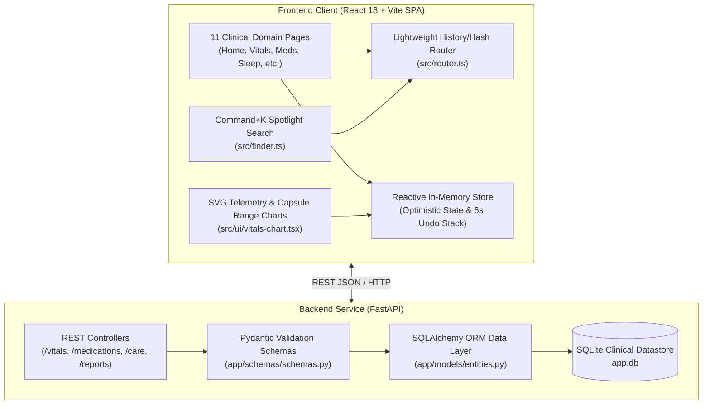
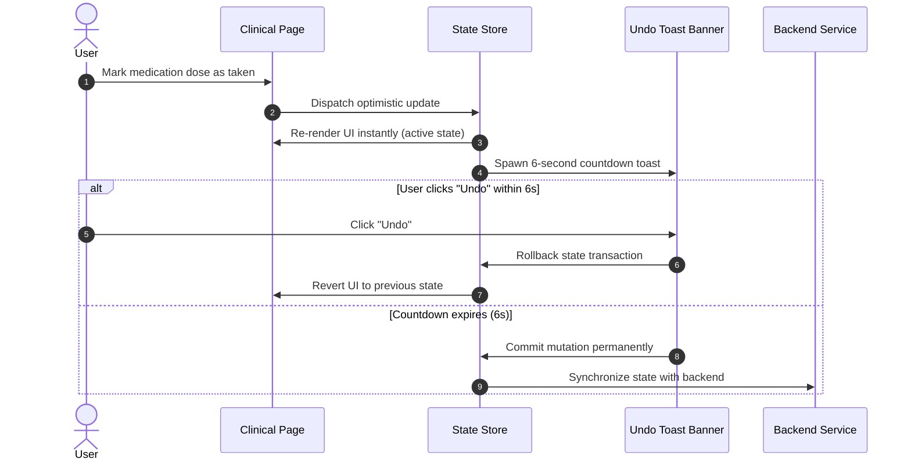

# Hälsa — Personal Health Record (PHR) Platform

<div align="center">


<p align="center">
  <strong>A privacy-focused, offline-capable Personal Health Record (PHR) application featuring live telemetry tracking, capsule range charts, optimistic state mutations with reversible undo workflows, and an integrated FastAPI clinical service.</strong>
</p>

[Key Features](#-key-features) •
[Architecture](#-system-architecture) •
[Clinical Domains](#-clinical-domains-matrix) •
[Design Tokens](#-design-system--tokens) •
[Quickstart](#-quickstart--local-setup) •
[API Reference](#-backend-api-endpoints) •
[Verification](#-testing--quality-assurance)

---

</div>

## ✨ Key Features

- **Ink & Lime Aesthetic**: Bespoke clinical UI engineered without bloated CSS frameworks, leveraging high-contrast accessible tokens (`#d6ff65` accent on `#17181b` dark frames).
- **Interactive Telemetry & SVG Range Visualizers**: High-low capsule range charts with dynamic mean markers, multi-day range scoping (7d, 14d, 30d), and simulated optical pulse waveform rendering.
- **Optimistic State with Reversible Undo**: Dose completions and metric adjustments update immediately with a 6-second atomic undo toast stack.
- **Command + K Spotlight Search**: Universal shortcut-driven fuzzy index for rapid navigation across clinical records, medications, appointments, and vitals.
- **Decoupled Architecture**: High-performance React 18 TypeScript frontend communicating with an async Python FastAPI backend backed by SQLite.

---

## 🏛 System Architecture



### State & Undo Workflow


---

## 📋 Clinical Domains Matrix

Hälsa organizes clinical telemetry and personal health records into 11 specialized domains:

| # | Domain Page | Route | Core Telemetry & Features | UX Highlights |
|---|---|---|---|---|
| 1 | **Home / Overview** | `#/` | Today's health vitals, daily pill schedule, rapid action buttons | High-level summary dashboard |
| 2 | **Vitals Telemetry** | `#/vitals` | Heart rate, SpO2, blood pressure, temperature, optical waveform | Capsule range SVG charts with mean baseline |
| 3 | **Active Health** | `#/activity` | Daily step count, active calories, workout logs | Interactive 4-4-4-4 Box Breathing pacing widget |
| 4 | **Sleep Analysis** | `#/sleep` | Sleep quality index, duration trends, stage breakdown | Deep, Light, REM & Awake distribution bar |
| 5 | **Medications** | `#/meds` | Dosing times (AM/Noon/PM), inventory pill counts | Reversible dose completion with 6-second undo |
| 6 | **Nutrition & Food** | `#/food` | Calorie summaries, macronutrient balance (P/C/F) | Interactive water glass hydration counter |
| 7 | **Clinical Records** | `#/records` | Lab diagnostics, blood panels, pathology, imaging | Abnormal clinical badge flags (High/Low/Normal) |
| 8 | **Health Reports** | `#/reports` | Multi-interval health history aggregation | Printable PDF-styled physician clinical summaries |
| 9 | **Care Directory** | `#/care` | Care team specialists, clinics, appointment schedules | Quick-contact telephone & portal launcher cards |
| 10 | **Emergency & Help** | `#/help` | Emergency contact speeds, acute guidance, hotlines | One-tap emergency dial actions |
| 11 | **Settings** | `#/settings` | Theme toggles (Ink/Lime Light vs Dark), data purge | LocalStorage export and privacy management |

---

## 🎨 Design System & Tokens

Hälsa uses the proprietary **Ink & Lime** design system built directly on CSS variables.

| CSS Variable | Light Theme | Dark Theme | Role & Surface Purpose |
|---|---|---|---|
| `--ground` | `#dfe3e6` | `#0f1012` | Viewport outer backdrop |
| `--frame` | `#ffffff` | `#17181b` | Main elevated application frame |
| `--lime` | `#d6ff65` | `#d6ff65` | High-visibility primary brand accent |
| `--on-lime` | `#2d2e33` | `#2d2e33` | High-contrast label color placed on lime |
| `--deep` | `#222328` | `#121316` | Telemetry cards, dark badges, and headers |
| `--card-alt` | `#f0f1f5` | `#26272b` | Secondary tiles, input backgrounds, subtle borders |
| `--ink` | `#2d2e33` | `#f1f2f4` | High-contrast primary typographic copy |
| `--muted` | `#67686e` | `#a3a4aa` | Secondary labels, units, and timestamps |

---

## 🚀 Quickstart & Local Setup

### System Prerequisites
- **Node.js**: v18.0.0 or higher
- **Python**: v3.10 or higher

### 1. Frontend Setup
```bash
# Navigate to the frontend directory
cd frontend

# Install dependencies
npm install

# Start development server
npm run dev
```
The client will start at `http://localhost:3000/`.

### 2. Backend Setup
```bash
# Navigate to the backend directory
cd backend

# Initialize Python virtual environment
python -m venv .venv

# Activate the virtual environment
# On Windows:
.venv\Scripts\activate
# On macOS / Linux:
source .venv/bin/activate

# Install required dependencies
pip install -r requirements.txt

# Run the FastAPI service
uvicorn app.main:app --host 127.0.0.1 --port 8000 --reload
```
Interactive Swagger API documentation will be available at `http://127.0.0.1:8000/docs`.

---

## 🔌 Backend API Endpoints

| Method | Endpoint | Description |
|---|---|---|
| `GET` | `/vitals` | Retrieve recorded vitals telemetry history |
| `POST` | `/vitals` | Record new vital sign entry (HR, SpO2, BP, Temp) |
| `GET` | `/medications` | Fetch list of active medications and dosing schedule |
| `POST` | `/medications/{id}/dose` | Log dose completion status |
| `GET` | `/care` | List medical team contacts and upcoming appointments |
| `POST` | `/care/appointments` | Schedule a new clinical consultation |
| `GET` | `/reports/summary` | Generate aggregated clinical summary payload |

---

## 🧪 Testing & Quality Assurance

### Frontend Test Suite (Vitest)
```bash
cd frontend
npm test
```
Verifies route resolution, reactive store subscriptions, optimistic action stack rollback, and utility formatters.

### Frontend Production Build
```bash
cd frontend
npm run build
```
Typechecks with `tsc` and compiles optimized production assets to `frontend/dist/`.

### Backend Test Suite (Pytest)
```bash
cd backend
pytest
```
Executes asynchronous test fixtures validating REST endpoints, validation logic, and SQLite database transactions.

---

## 📂 Repository Reference

- [ARCHITECTURE.md](ARCHITECTURE.md): Comprehensive system design specifications (HLD, LLD, DFD, Sequence diagrams).
- [CHECKLIST.md](CHECKLIST.md): Feature implementation checklist across all 11 application domains.
- [GEMINI.md](GEMINI.md): Project memory, operational guidelines, and state store contracts for AI agents.
- [LICENSE](LICENSE): Open-source MIT license statement.
